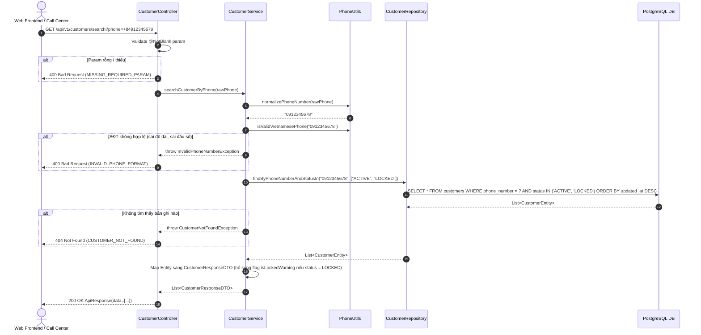

# Ví Dụ Thiết Kế Kỹ Thuật Chuẩn (Technical Design Example - Reference Only)

> **Tài liệu tham khảo Level 3**: Minh họa một tài liệu thiết kế kỹ thuật (`02-design.md`) hoàn chỉnh, chuẩn mực cho Cổng G2.  
> **Nguyên tắc cốt lõi của Phase 2**: **Định hướng giải pháp (WHAT/FLOW/TOUCH POINTS)**, xác định rõ luồng xử lý, gọi hàm nào, qua đâu, API contract và ADR. **TUYỆT ĐỐI KHÔNG viết code chi tiết / pseudocode dài dòng** (để Phase 3 tự khảo sát code repo thực tế và triển khai).

---

# 02 – Thiết Kế – CRM-123 – T1: Tìm kiếm & tra cứu thông tin khách hàng qua số điện thoại

> **Mục tiêu**: Định hướng giải pháp kỹ thuật cho subtask T1 trong `service-a`.  
> **Trạng thái**: Đã qua kiểm tra độc lập bởi agent `design-review` – Sẵn sàng trình duyệt Cổng G2.

<design_checklist>
  <items>
    <item id="1">✅ Đọc TX-&lt;slug&gt;/01-requirement.md (đã duyệt G1)</item>
    <item id="2">✅ Gọi agent impact-analysis (khảo sát pattern Customer & Repository hiện hữu)</item>
    <item id="3">✅ Đánh giá effort level (🟡 Medium Effort - Sonnet/Flash)</item>
    <item id="4">✅ Bảng ADR: 3 quyết định kỹ thuật có 2-3 phương án kèm ưu/nhược và lý do</item>
    <item id="5">✅ Luồng xử lý: Sequence diagram và step-by-step trace qua từng component</item>
    <item id="6">✅ Components to Modify: Touch points table với relative file path và định hướng thay đổi</item>
    <item id="7">✅ API Contract & DB Schema: Đặc tả request/response JSON và Flyway migration</item>
    <item id="8">✅ Build command & Verification: Lệnh build sạch thực tế</item>
    <item id="9">✅ Gọi agent design-review trước G2: Đã giải quyết toàn bộ findings</item>
  </items>
</design_checklist>

---

## 1. Bối Cảnh

- **Requirement**: `docs/dev/CRM-123/T1-search-customer/01-requirement.md` (đã được Dev duyệt tại Cổng G1).
- **Mục tiêu kỹ thuật**: Cung cấp API nội bộ cho nhân viên tổng đài tìm kiếm nhanh hồ sơ khách hàng bằng số điện thoại (hỗ trợ tự động chuẩn hóa đầu số `+84`/`0` và hiển thị cảnh báo nếu khách hàng bị `LOCKED`).
- **Phạm vi tác động**: Microservice `service-a` (Spring Boot 3, Java 17, JPA/Hibernate, PostgreSQL/H2).

---

## 2. Effort Level & Lựa Chọn Model

- **Đánh giá Effort**: 🟡 **Medium Effort**
- **Lý do**:
  - Chạm vào 4 components trong 1 service (`service-a`).
  - Có logic chuẩn hóa SĐT và xử lý phân nhánh tìm kiếm (Active vs Locked).
  - Không thay đổi cấu trúc bảng chính, chỉ bổ sung composite index để tối ưu tốc độ truy vấn.
- **Model khuyến nghị cho Phase 3**: **Sonnet / Flash** (Đủ năng lực đọc hiểu code repo hiện hữu và triển khai theo định hướng thiết kế này).

---

## 3. Bảng Quyết Định Kỹ Thuật (ADR - Architecture Decision Record)

| # | Quyết định | Phương án A (Đề xuất) | Phương án B | Phương án C | Chọn | Lý do lựa chọn |
|---|------------|------------------------|-------------|-------------|------|----------------|
| 1 | **Thiết kế REST Endpoint** | `GET /api/v1/customers/search?phone={phone}` | `GET /api/v1/customers/by-phone/{phone}` | `POST /api/v1/customers/search` kèm JSON body | ✅ **Phương án A** | Chuẩn RESTful query param cho thao tác tìm kiếm/lọc, dễ dàng mở rộng thêm các tiêu chí lọc khác (email, name) trong các ticket sau mà không phá vỡ URI pattern. |
| 2 | **Vị trí chuẩn hóa SĐT & Validate** | Thực hiện tại tầng Service qua static utility `PhoneUtils.normalize()` | Tự động chuẩn hóa trong JPA Entity `@PrePersist` / DB Trigger | Thực hiện trực tiếp tại Custom Spring Validator trên DTO | ✅ **Phương án A** | Độc lập với DB, dễ viết Unit Test độc lập (Fast Test), tái sử dụng được logic chuẩn hóa ở cả luồng Search lẫn luồng Create/Update. |
| 3 | **Chiến lược xử lý ngoại lệ khi không tìm thấy** | Ném `CustomerNotFoundException` → ControllerAdvice map về HTTP `404 Not Found` kèm RFC 7807 problem details | Trả về HTTP `200 OK` kèm `data: null` và `message: "Not found"` | Trả về HTTP `204 No Content` rỗng hoàn toàn | ✅ **Phương án A** | Tuân thủ convention API chung của workspace (`.wiki/api-standards.md`), phân biệt rõ giữa thành công có dữ liệu và lỗi nghiệp vụ không tìm thấy tài nguyên. |

---

## 4. Luồng Xử Lý (Sequence Flow)

### 4.1. Sơ đồ tuần tự



### 4.2. Trình tự thực thi chi tiết
1. **Controller Layer**: Tiếp nhận HTTP GET request, trích xuất `@RequestParam("phone") String phone`. Sử dụng Jakarta validation `@NotBlank`.
2. **Service Layer**:
   - Gọi `PhoneUtils.normalizePhoneNumber(phone)`: Cắt bỏ khoảng trắng, dấu gạch nối, chuyển tiền tố `+84` hoặc `84` thành `0`.
   - Kiểm tra định dạng hợp lệ qua regex nội địa Việt Nam: `^0(3|5|7|8|9)\d{8}$`. Nếu vi phạm ném `InvalidPhoneNumberException`.
   - Gọi Repository để truy vấn danh sách khách hàng có SĐT tương ứng với trạng thái hợp lệ (`ACTIVE`, `LOCKED`) theo thứ tự cập nhật mới nhất trước.
   - Nếu danh sách rỗng, ném `CustomerNotFoundException`.
   - Chuyển đổi danh sách `Customer` entity sang `CustomerResponseDTO`, gắn trường cảnh báo `lockedWarning = true` nếu khách hàng có trạng thái `LOCKED`.
3. **Response**: Đóng gói danh sách vào `ApiResponse<List<CustomerResponseDTO>>` và trả về mã HTTP 200.

---

## 5. Hướng Dẫn Triển Khai (Components to Modify - Touch Points)

> 💡 **Lưu ý**: Bảng này chỉ rõ **VỊ TRÍ, PHƯƠNG THỨC và TÁC VỤ CẦN THỰC HIỆN (WHAT)**. Không viết toàn bộ mã nguồn của hàm.

| Layer | Relative File Path | Action | Phương thức / Class | Định hướng thay đổi (WHAT to do) |
|---|---|---|---|---|
| **Controller** | `src/service-a/src/main/java/com/crm/controller/CustomerController.java` | Modify | `searchCustomer(@RequestParam String phone)` | Thêm endpoint `@GetMapping("/api/v1/customers/search")`, validate `@NotBlank`, ủy quyền xử lý cho `CustomerService.searchByPhone()`. |
| **Service** | `src/service-a/src/main/java/com/crm/service/CustomerService.java` | Modify | `searchByPhone(String rawPhone)` | Khai báo method trong interface và implement logic: gọi chuẩn hóa `PhoneUtils`, kiểm tra regex, query repo, map DTO và throw exception tương ứng. |
| **Utility** | `src/service-a/src/main/java/com/crm/util/PhoneUtils.java` | Create / Modify | `normalize(String)`, `isValid(String)` | Tái sử dụng hoặc bổ sung 2 static methods: làm sạch ký tự lạ (`+84`, khoảng trắng) và kiểm tra regex SĐT di động Việt Nam. |
| **Repository** | `src/service-a/src/main/java/com/crm/repository/CustomerRepository.java` | Modify | `findByPhoneNumberAndStatusInOrderByUpdatedAtDesc(...)` | Khai báo Spring Data JPA query method để tìm theo số điện thoại và danh sách trạng thái, sắp xếp `updatedAt DESC`. |
| **DTO** | `src/service-a/src/main/java/com/crm/dto/CustomerResponseDTO.java` | Modify | Các fields DTO | Đảm bảo DTO chứa: `id`, `fullName`, `phoneNumber`, `email`, `status`, `lockedWarning` (boolean). |
| **Exception** | `src/service-a/src/main/java/com/crm/exception/GlobalExceptionHandler.java` | Modify | `@ExceptionHandler({CustomerNotFoundException.class, InvalidPhoneNumberException.class})` | Ánh xạ lỗi nghiệp vụ sang mã HTTP tương ứng (404 và 400) theo format `ErrorResponse`. |

---

## 6. Đặc Tả Giao Diện & Dữ Liệu (Contracts)

### 6.1. API Contract

**Endpoint**: `GET /api/v1/customers/search`

- **Request Query Parameters**:
  - `phone` (String, required): Số điện thoại cần tìm (VD: `0912345678`, `+84912345678`, `0912 345 678`).

- **Response 200 OK (Thành công - Tìm thấy khách hàng)**:
```json
{
  "success": true,
  "data": [
    {
      "id": 1052,
      "fullName": "Nguyễn Văn A",
      "phoneNumber": "0912345678",
      "email": "vana.nguyen@example.com",
      "status": "LOCKED",
      "lockedWarning": true,
      "updatedAt": "2026-11-01T08:30:00Z"
    }
  ],
  "message": "Tìm thấy thông tin khách hàng"
}
```

- **Response 400 Bad Request (Số điện thoại không hợp lệ)**:
```json
{
  "success": false,
  "errorCode": "INVALID_PHONE_FORMAT",
  "message": "Số điện thoại không đúng định dạng di động Việt Nam hợp lệ (cần 10 chữ số)"
}
```

- **Response 404 Not Found (Không tìm thấy khách hàng)**:
```json
{
  "success": false,
  "errorCode": "CUSTOMER_NOT_FOUND",
  "message": "Không tìm thấy hồ sơ khách hàng với số điện thoại đã cung cấp"
}
```

### 6.2. Database Changes (Migration Script)

- **Bảng tác động**: `customers`
- **Thay đổi**: Bổ sung composite index trên 2 cột `(phone_number, status)` để tăng tốc độ truy vấn khi bảng có hàng triệu dòng.
- **Migration file**: `src/service-a/src/main/resources/db/migration/V1_2__add_index_customer_phone_status.sql`

```sql
-- Migration: V1_2__add_index_customer_phone_status.sql
CREATE INDEX IF NOT EXISTS idx_customers_phone_status 
ON customers (phone_number, status);
```

- **Rollback script**:
```sql
DROP INDEX IF EXISTS idx_customers_phone_status;
```

---

## 7. Kế Hoạch Kiểm Thử & Lệnh Build (Verification)

### 7.1. Lệnh build xác minh
```powershell
mvn -q -DskipTests package -f src/service-a/pom.xml
```

### 7.2. Phạm vi Unit & Integration Test cần viết tại Phase 3
1. `PhoneUtilsTest`:
   - Chuẩn hóa đầu số `+84` $\to$ `0`.
   - Chuẩn hóa chuỗi có dấu cách `0912 345 678` $\to$ `0912345678`.
   - Validate đầu số hợp lệ (03, 05, 07, 08, 09) và từ chối SĐT quá ngắn hoặc chứa chữ cái.
2. `CustomerServiceTest`:
   - Mock repository trả về khách hàng `ACTIVE` $\to$ map DTO thành công, `lockedWarning = false`.
   - Mock repository trả về khách hàng `LOCKED` $\to$ `lockedWarning = true`.
   - Mock repository trả về rỗng $\to$ ném `CustomerNotFoundException`.
3. `CustomerControllerTest`:
   - Verify HTTP 200, HTTP 400 và HTTP 404 response status codes.

---

## 8. Báo Cáo Đánh Giá Của Agent Độc Lập (Design Review)

- **Agent thực hiện**: `design-review`
- **Thời điểm thực hiện**: Trước khi trình duyệt Cổng G2
- **Kết quả đánh giá**:
  - Khớp với yêu cầu nghiệp vụ tại `01-requirement.md`: ✅ Đạt (Bao phủ cả `BR-1`, `BR-2`, `BR-3`, `AC-1`, `AC-2`).
  - Kiến trúc & Tách lớp: ✅ Đạt (Controller mỏng, logic chuẩn hóa đưa vào Util/Service, Repo chỉ thuần truy vấn).
  - Vấn đề phát hiện ban đầu:
    - *Finding 1*: Ban đầu thiết kế chỉ tìm kiếm khách hàng `ACTIVE`. Agent phát hiện requirement `BR-3` yêu cầu hỗ trợ tra cứu cả tài khoản `LOCKED` để hướng dẫn khách mở khóa.
    - *Khắc phục*: Đã cập nhật truy vấn Repository thành `findByPhoneNumberAndStatusIn` với danh sách `['ACTIVE', 'LOCKED']` và bổ sung trường `lockedWarning` vào DTO.

