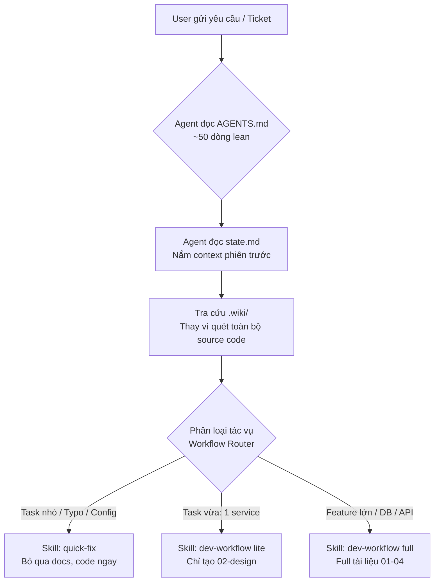
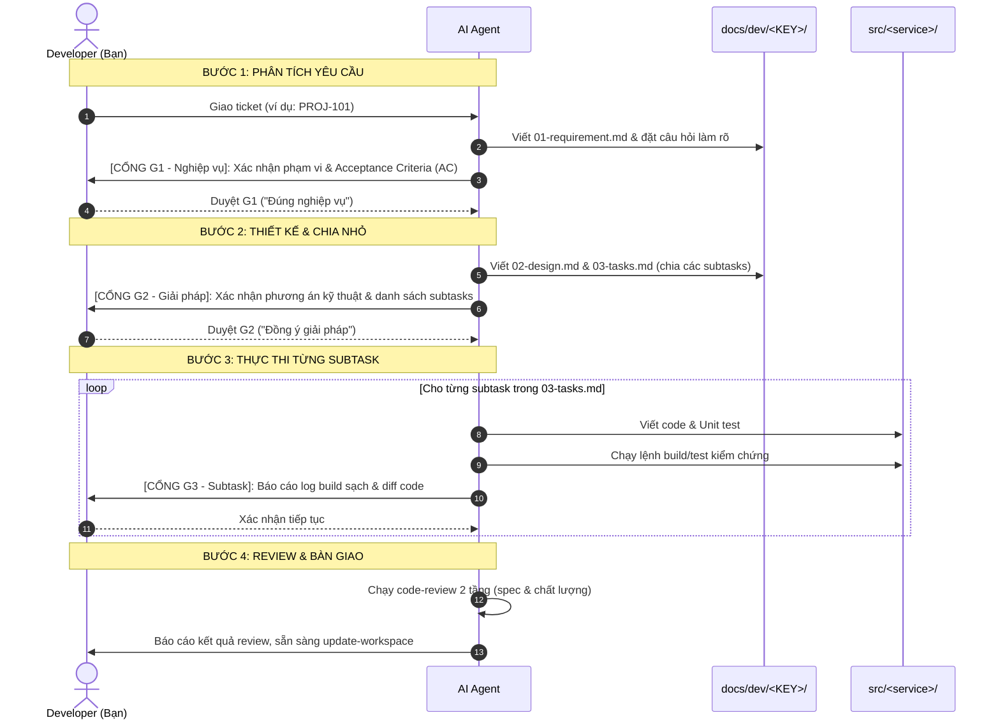

# AI Workspace – Developer & AI Guide

> **AI-Assisted Development Workspace** chuẩn hóa cho hệ sinh thái Microservices.  
> Workspace đóng vai trò "bàn làm việc thông minh" kết nối Developer và AI Agent (Antigravity IDE, Claude Code, Kiro) với các kho mã nguồn microservice, tối ưu hóa quy trình phân tích – thiết kế – cài đặt – kiểm thử, và tối ưu hóa **chi phí token**.

---

## 📑 Mục lục
1. [Tại sao cần Workspace này?](#1-tại-sao-cần-workspace-này)
2. [Bản đồ cấu trúc thư mục & Ý nghĩa từng file](#2-bản-đồ-cấu-trúc-thư-mục--ý-nghĩa-từng-file)
3. [Cơ chế hoạt động của AI Agent & Tiết kiệm Token](#3-cơ-chế-hoạt-động-của-ai-agent--tiết-kiệm-token)
4. [Quy trình phát triển (Workflow Router) & 3 Cổng xác nhận (Gates)](#4-quy-trình-phát-triển-workflow-router--3-cổng-xác-nhận-gates)
5. [Hướng dẫn sử dụng thực tế (Step-by-Step Guide)](#5-hướng-dẫn-sử-dụng-thực-tế-step-by-step-guide)
6. [Phân quyền theo Role & Ma trận Model Tiering](#6-phân-quyền-theo-role--ma-trận-model-tiering)
7. [Các nguyên tắc an toàn bắt buộc (Non-Negotiable Rules)](#7-các-nguyên-tắc-an-toàn-bắt-buộc-non-negotiable-rules)
8. [Câu hỏi thường gặp (FAQ)](#8-câu-hỏi-thường-gặp-faq)

---

## 1. Tại sao cần Workspace này?

Trong kiến trúc Microservices, mỗi dịch vụ nằm ở một repository riêng biệt (`service-a`, `frontend`,...). Khi phát triển tính năng mới hoặc sửa lỗi liên dịch vụ:
- ❌ **Developer & AI gặp khó khăn**: Phải mở nhiều cửa sổ IDE, clone nhiều repo, AI liên tục phải quét lại hàng chục ngàn dòng code để hiểu bối cảnh → **Rất chậm và cực kỳ tốn chi phí token**.
- ❌ **Thiếu tài liệu theo ngữ cảnh**: Quyết định kỹ thuật nằm rải rác trên Jira/Slack/Confluence, không có sự liên kết chặt chẽ giữa yêu cầu (BRD) và code thực tế.
- ❌ **Rủi ro AI "tự biên tự diễn"**: AI tạo code sai nghiệp vụ do không có các trạm kiểm soát (Confirmation Gates) trước khi đụng vào source code.

**AI Workspace giải quyết triệt để vấn đề trên bằng cách:**
- 🔗 **Hội tụ Git Submodules**: Gom toàn bộ mã nguồn các microservices về thư mục `src/` để quản lý tập trung nhưng vẫn giữ commit độc lập.
- 🧠 **Cơ chế Wiki-First Knowledge Base**: Tạo bản tóm tắt kiến trúc (`.wiki/`) để AI tra cứu nhanh cấu trúc, luồng, API và DB schema thay vì quét toàn bộ source code.
- 🛡️ **3 Cổng kiểm duyệt nghiêm ngặt (G1, G2, G3)**: Buộc AI phải làm rõ nghiệp vụ và thiết kế kỹ thuật trước khi được phép gõ dòng code đầu tiên.
- 💾 **Lưu trữ trạng thái liên phiên (`state.md`)**: AI biết ngay phiên làm việc trước dừng ở đâu, không cần hỏi lại từ đầu.

---

## 2. Bản đồ cấu trúc thư mục & Ý nghĩa từng file

```
ai-workspace/
├── 📄 AGENTS.md                  # ⭐ Core Rules chuẩn hóa (nạp tự động mỗi session cho Antigravity)
├── 📄 CLAUDE.md                  # Core Rules chuẩn hóa (đồng bộ 100% với AGENTS.md cho Claude Code)
├── 📄 README.md                  # Tài liệu hướng dẫn toàn diện (file bạn đang đọc)
├── 📄 state.md                   # Bảng theo dõi trạng thái workspace & bàn giao ca
├── 📄 .agentsignore              # Bộ lọc tàng hình cho Antigravity (đồng bộ với .kiroignore)
├── 📄 .kiroignore                # Bộ lọc bảo mật & tối ưu context cho Kiro (đồng bộ với .agentsignore)
├── 📄 .gitignore                 # Chặn commit tài liệu nội bộ / tạm thời lên Git
├── 📄 .gitmodules                # Khai báo liên kết các Git Submodules
│
├── 📁 src/                       # Nơi chứa mã nguồn các microservices (Git Submodules)
│   ├── service-a/                # └── Backend service (Java / Spring Boot / Maven)
│   └── frontend/                 # └── Frontend service (React / Vite / Node)
│
├── 📁 .wiki/                     # KNOWLEDGE BASE (Source of Truth của hệ thống, được commit & push)
│   ├── index.md                  # └── Mục lục điều hướng toàn hệ thống
│   ├── system-overview.md        # └── [CHUNG] Kiến trúc tổng quan, tech stack, hạ tầng dùng chung
│   └── services/                 # └── [RIÊNG BIỆT] Tri thức chia theo từng microservice (tiết kiệm token)
│       ├── service-a/            #     └── overview, architecture, api-contracts, database
│       └── frontend/             #     └── overview, architecture, api-integration
│
├── 📁 docs/                      # TÀI LIỆU DỰ ÁN & THEO DÕI TICKET (Không commit)
│   ├── ba/                       # └── Tài liệu phân tích nghiệp vụ (BRD, Use Case)
│   ├── sit/                      # └── Tài liệu kiểm thử hệ thống (Test plan, Test cases)
│   ├── roles-permissions.md      # └── Ma trận phân quyền truy cập giữa các vai trò
│   └── dev/<JIRA-KEY>/           # └── Bộ hồ sơ kỹ thuật cho từng ticket (Ví dụ: PROJ-101)
│       ├── 01-requirement.md     #     └── Bước 1: Yêu cầu, AC (Acceptance Criteria), Scope & quyết định nghiệp vụ
│       ├── 02-design.md          #     └── Bước 2: Thiết kế kỹ thuật, API Contract, DB Schema & bảng ADR
│       └── 03-tasks.md           #     └── Bước 2 & 3: Danh sách subtasks & lệnh build kiểm chứng
│
├── 📁 .agents/                   # ⭐ SINGLE SOURCE OF TRUTH CHO SKILLS (Antigravity)
│   ├── rules/                    # └── Contextual rules (dev-rules.md)
│   └── skills/                   # └── THƯ VIỆN 10 WORKFLOW SKILLS DÙNG CHUNG (Unified Skills)
│       ├── dev-workflow/         #     ├── Workflow chuẩn 4 bước (Full + Lite mode + templates)
│       ├── quick-fix/            #     ├── Fast-track cho task nhỏ (≤3 file, config, typo)
│       ├── clone-workspace/      #     ├── Kéo submodules & khởi tạo state ban đầu
│       ├── update-workspace/     #     ├── Sync wiki, state.md & dọn dẹp sau khi xong
│       ├── impact-analysis/      #     ├── Khảo sát phạm vi ảnh hưởng chéo
│       ├── design-review/        #     ├── Review thiết kế độc lập trước G2
│       ├── code-review/          #     ├── Review chất lượng mã nguồn sau khi code
│       ├── ba-workflow/          #     ├── Phân tích nghiệp vụ & soạn BRD (PO/BA)
│       ├── po-workflow/          #     ├── Làm rõ & ưu tiên đầu bài (PO)
│       └── sit-workflow/         #     └── Thiết kế test & log bug (SIT/QA)
│
├── 📁 .kiro/                     # CẤU HÌNH TỐI ƯU CHO KIRO IDE
│   ├── settings.json             # └── Cấu hình workspace Kiro (ignore files, paths)
│   ├── steering/                 # └── Workspace Steering (workspace.md đồng bộ 100% với AGENTS.md)
│   ├── skills/                   # └── 🔗 Junction trỏ về .agents/skills (dùng chung 100%, 0 duplicate)
│   ├── agents/                   # └── 🔗 Junction trỏ về .claude/agents (dùng chung sub-agents)
│   └── specs/                    # └── Tích hợp Spec-Driven Development với docs/dev/
│
├── 📁 .claude/                   # CẤU HÌNH CHO CLAUDE CODE CLI
│   ├── agents/                   # └── Sub-agents chuyên trách (refactoring, test-writing, wiki-maintenance...)
│   └── skills/                   # └── 🔗 Junction trỏ về .agents/skills (dùng chung 100%, 0 duplicate)
│
└── 📁 scripts/                   # CÔNG CỤ ĐỒNG BỘ HARNESS
    ├── sync-harnesses.ps1        # └── Script quản lý liên kết/đồng bộ Junction trên Windows
    └── sync-harnesses.sh         # └── Script quản lý liên kết Symlink trên Linux/macOS
```

---

## 3. Cơ chế hoạt động của AI Agent & Tiết kiệm Token

Workspace được thiết kế theo nguyên lý **Progressive Disclosure (Mở rộng dần thông tin)** và **Wiki-First**:



### Các kỹ thuật tối ưu chi phí Token cốt lõi:
1. **Quy tắc cốt lõi tinh gọn (`AGENTS.md`)**: Chỉ dài ~50 dòng, cung cấp chỉ dẫn tối cần thiết. Chi tiết nghiệp vụ được nạp qua Skills khi cần.
2. **Bộ lọc file rác (`.agentsignore`)**: Ngăn AI quét các thư mục build nặng (`target/`, `node_modules/`, `dist/`, `.git/`, file binary, lock files), giảm hàng trăm ngàn token vô ích.
3. **Triết lý Wiki-First**: Trước khi đọc bất kỳ file `.java` hay `.tsx` nào, AI bắt buộc phải tra `.wiki/`. Chỉ khi wiki thiếu thông tin, AI mới dùng `grep_search` vào vùng code mục tiêu.
4. **Bộ nhớ liên phiên (`state.md`)**: Khi chuyển sang chat mới, AI đọc ngay `state.md` để nắm rõ ticket hiện tại, branch đang đứng, các gotchas đã xử lý mà không cần người dùng giải thích lại.

---

## 4. Quy trình phát triển (Workflow Router) & 3 Cổng xác nhận (Gates)

Để đảm bảo AI không sinh mã rác và đi đúng hướng, workspace áp dụng bảng điều hướng và 3 cổng xác nhận bắt buộc:

### 4.1. Bảng điều hướng quy trình (Workflow Router)

| Loại công việc | Kỹ năng sử dụng | Hồ sơ tài liệu yêu cầu | Cổng duyệt | Token ước tính |
|---|---|---|---|---|
| **Sửa nhỏ (Quick-Fix)**<br>Typo, config, message, log, rename (≤3 file, ≤50 dòng, không đụng logic) | `quick-fix` | ❌ Không cần tài liệu | Xác nhận scope 1 câu | ~500 – 1.000 token *(Giảm 90%)* |
| **Tính năng vừa (Lite Mode)**<br>Thay đổi logic nội bộ trong phạm vi 1 service, scope rõ ràng | `dev-workflow` *(Lite)* | `02-design.md`<br>`03-tasks.md` | Duyệt G2 gọn, G3 theo subtask | ~3.000 – 5.000 token *(Giảm 60%)* |
| **Tính năng lớn (Full Mode)**<br>Cross-service, thay đổi DB schema, sửa API contract, tính năng mới | `dev-workflow` *(Full)* | Bộ 3 file kỹ thuật:<br>`01` → `03` | Bắt buộc đủ 3 cổng:<br>**G1 → G2 → G3** | Chuẩn hóa theo từng subtask |

---

### 4.2. Chi tiết 3 Cổng xác nhận (Confirmation Gates)

> [!IMPORTANT]
> **AI TUYỆT ĐỐI KHÔNG ĐƯỢC PHÉP CODE** nếu chưa vượt qua Cổng G2 (hoặc G1 đối với task Full). Mọi quyết định duyệt phải được ghi nhận trực tiếp vào tài liệu kỹ thuật (`01-requirement.md`, `02-design.md`) và đồng bộ lên `state.md`.



- 🟢 **Cổng G1 (Xác nhận Nghiệp vụ)**: AI trình bày bản tóm tắt yêu cầu, phạm vi In/Out, danh sách Acceptance Criteria có thể đo lường và các điểm chưa rõ. Developer bấm duyệt hoặc giải đáp thắc mắc.
- 🟡 **Cổng G2 (Xác nhận Giải pháp)**: AI trình bày giải pháp kỹ thuật, API schema, thay đổi DB, và bảng chia nhỏ subtasks (mỗi subtask độc lập, kiểm chứng được). Developer kiểm tra kiến trúc trước khi AI sửa code.
- 🔵 **Cổng G3 (Xác nhận Subtask)**: **Bắt buộc dừng lại sau mỗi subtask**. AI chạy build/test và báo cáo kết quả kiểm chứng kèm diff code. Chỉ khi Developer kiểm tra và xác nhận duyệt ("OK") thì AI mới được phép bắt đầu subtask kế tiếp.

---

## 5. Hướng dẫn sử dụng thực tế (Step-by-Step Guide)

### 5.1. Bắt đầu phiên làm việc đầu tiên
1. **Mở thư mục gốc `ai-workspace`** trong IDE (ưu tiên **Kiro IDE**, hoặc Google Antigravity, Claude Code).
2. **Cơ chế tự động của Kiro khi khởi động**:
   - Tự động nạp `.kiro/steering/workspace.md` (chế độ `inclusion: always`).
   - Tự động kích hoạt bộ lọc `.kiroignore` để loại trừ file rác và bảo vệ bí mật / credentials.
   - Tuân thủ nguyên tắc **Wiki-First**: Khi thao tác với bất kỳ service nào trong `src/`, AI sẽ tra cứu `.wiki/services/<service>/` để lấy đúng tech stack, lệnh test/build và quy chuẩn kiến trúc.
3. **Kéo mã nguồn và khởi tạo trạng thái**:
   - Chat trong Kiro hoặc dùng slash command: `/clone-workspace` (hoặc *"Hãy chạy skill clone-workspace để kéo code các service"*).
   - Kiro sẽ cập nhật các git submodules trong `src/` về đúng nhánh và khởi tạo trạng thái ban đầu trong `state.md`. Tuyệt đối không đọc quét code sinh mới wiki ở bước này để tiết kiệm tối đa token (wiki đã có sẵn trong repo làm Source of Truth chung và chỉ cập nhật khi kết thúc ticket).

### 5.2. Khi bắt đầu làm một Ticket mới
- Cung cấp mã ticket và mô tả cho AI:
  > *"Tôi cần làm ticket PROJ-101: Bổ sung trường ngày sinh (dateOfBirth) cho thông tin người dùng và hiển thị trên giao diện thông tin cá nhân."*
- AI sẽ tự động:
  1. Kiểm tra bảng router → Nhận diện đây là task cần sửa cả Backend (`service-a`) và Frontend (`frontend`) → Kích hoạt `dev-workflow` (Full mode).
  2. Tạo nhánh Git mới: `feature/PROJ-101-bo-sung-ngay-sinh` trong từng repo tương ứng.
  3. Tạo thư mục `docs/dev/PROJ-101/`.
  4. Lập tài liệu `01-requirement.md` và dừng lại xin phê duyệt **Cổng G1**.

### 5.3. Tương tác tại các Cổng phê duyệt
- **Tại G1**: Đọc tóm tắt của AI, chỉnh sửa nếu AI hiểu sai logic nghiệp vụ, sau đó gõ *"Duyệt G1"*.
- **Tại G2**: AI lập phương án kỹ thuật và danh sách subtask. Kiểm tra xem cấu trúc DB/API có chuẩn không. Nếu đồng ý, gõ *"Duyệt G2, hãy tiến hành subtask 1"*.
- **Tại G3**: AI thực hiện code, chạy test tự động (`mvn test` hoặc `npm test`). Khi xanh đèn, AI báo cáo kết quả và hỏi ý kiến trước khi làm subtask kế tiếp.

### 5.4. Khi hoàn thành Ticket
- Yêu cầu AI: *"Hãy tổng kết ticket và chạy update-workspace."*
- AI sẽ:
  1. Chạy review code 2 tầng (đúng spec & chất lượng) và kiểm tra diff sạch.
  2. Cập nhật các thay đổi mới vào Knowledge Base `.wiki/`.
  3. Cập nhật `state.md` ghi nhận ticket đã hoàn thành (Phase 6 DONE).
  4. Hướng dẫn developer câu lệnh để commit code trong từng submodule `src/<service>`.

---

## 6. Phân quyền theo Role & Ma trận Model Tiering

### 6.1. Ma trận phân quyền theo vai trò (Roles Matrix)

| Vai trò | Workflow chính | Quyền trên `/src` (Code) | Quyền trên `.wiki/` | Quyền trên `docs/` |
|---|---|---|---|---|
| **DEV (Developer)** | `dev-workflow`, `quick-fix` | ✅ **Full Access** (Read/Write) | 📝 Read / Write | 📝 Write (`docs/dev/`) |
| **PO / BA** | `po-workflow`, `ba-workflow` | ❌ **Không truy cập** | 📖 Read Only | 📝 Write (`docs/ba/`) |
| **SIT (Tester)** | `sit-workflow` | ❌ **Không truy cập** | 📖 Read Only | 📝 Write (`docs/sit/`) |

---

### 6.2. Hướng dẫn tối ưu lựa chọn Mô hình (Model Tiering)

Không nhất thiết phải dùng mô hình mạnh nhất (đắt nhất) cho mọi công đoạn. Hãy chuyển đổi linh hoạt mô hình theo bảng sau để tối ưu hiệu năng và chi phí:

| Giai đoạn / Tác vụ | Mô hình khuyến nghị | Lý do kỹ thuật |
|---|---|---|
| **Phân tích yêu cầu, Thiết kế kiến trúc, Review**<br>(Giai đoạn G1, G2, Impact Analysis, Code Review) | **High-Tier / Reasoning** | Đòi hỏi tư duy sâu, phân tích logic chéo hệ thống và bao quát rủi ro edge-cases. |
| **Lập trình theo kế hoạch (Implementation)**<br>(Thực thi từng subtask cụ thể đã có sẵn task plan) | **Medium-Tier / Fast** | Thiết kế đã có sẵn, AI chỉ cần tập trung viết code chuẩn cú pháp và bám sát spec. |
| **Quick-fix, Viết Unit Test, Viết Docs, Refactor**<br>(Sửa typo, config, sync wiki, format tài liệu) | **Low-Tier / Ultra-Fast** | Tác vụ mang tính chất lặp lại, cấu trúc rõ ràng, tiết kiệm tối đa ngân sách token. |

---

## 7. Các nguyên tắc an toàn bắt buộc (Non-Negotiable Rules)

1. **Tuyệt đối không tự ý commit / push**: AI không được tự động chạy `git commit` hay `git push`. Developer là người kiểm tra diff cuối cùng và thực hiện push.
2. **Không commit tài liệu tạm thời**: Không bao giờ đưa `docs/` (`ba`, `dev`, `sit`) và `state.md` vào Git. Riêng `.wiki/` **được phép commit và push** lên workspace repository vì đây là Source of Truth chung cho cả team.
3. **Phát triển trên nhánh Feature**: Mọi thay đổi code phải nằm trên nhánh `feature/<KEY>-<mo-ta>` hoặc `bugfix/...`, tuyệt đối không code trực tiếp trên `develop` hay `master`.
4. **Bảo mật thông tin tối thượng**: Tuyệt đối không đưa API keys, Secret tokens, mật khẩu hoặc dữ liệu khách hàng thật vào mã nguồn, log, wiki hay tài liệu markdown.
5. **Dừng lại khi lặp lỗi (Rule of 2)**: Nếu sửa cùng một lỗi kiểm thử quá 2 lần không thành công, AI phải lập tức dừng lại, báo cáo nguyên nhân và đề xuất hướng tiếp cận khác cho developer.

---

## 8. Câu hỏi thường gặp (FAQ)

<details>
<summary><b>Q: Thư mục .wiki/ khác thư mục docs/ như thế nào?</b></summary>
<br>
- <b><code>.wiki/</code></b> là <i>Knowledge Base toàn cục</i> của hệ thống, mang tính dài hạn (kiến trúc chung, sơ đồ liên kết API, cấu trúc bảng DB). Nó giúp AI hiểu bức tranh tổng thể.<br>
- <b><code>docs/</code></b> là <i>hồ sơ theo từng phiên bản/ticket cụ thể</i> (như <code>docs/dev/PROJ-101/</code>). Nó chứa biên bản phân tích, bản thiết kế giải pháp và bằng chứng kiểm thử của riêng ticket đó.
</details>

<details>
<summary><b>Q: Làm sao để thêm một microservice mới vào workspace?</b></summary>
<br>
Chạy lệnh thêm Git Submodule từ thư mục gốc của workspace:
<pre><code>git submodule add -b develop &lt;repo-git-url&gt; src/&lt;service-name&gt;</code></pre>
Sau đó mở file <code>AGENTS.md</code> và <code>CLAUDE.md</code> để bổ sung câu lệnh Build / Test / Lint của service đó vào bảng cấu hình.
</details>

<details>
<summary><b>Q: Tại sao trong workspace có cả .agents/, .claude/ và .kiro/? Có bị phân mảnh hay trùng lặp không?</b></summary>
<br>
<b>Hoàn toàn không bị trùng lặp!</b> Workspace áp dụng mô hình <b>Single Source of Truth</b>:
<ul>
  <li>Thư mục <code>.agents/skills/</code> là nơi lưu trữ duy nhất cho toàn bộ 10 workflow skills chuẩn.</li>
  <li><code>.claude/skills/</code> và <code>.kiro/skills/</code> là <b>Directory Junctions</b> liên kết trực tiếp về <code>.agents/skills/</code>. Bạn sửa ở một nơi thì cả 3 harness đều nhận cập nhật ngay lập tức.</li>
  <li>Tương tự, <code>.kiro/agents/</code> liên kết trực tiếp tới <code>.claude/agents/</code> để dùng chung sub-agents chuyên trách (refactoring, wiki-maintenance...).</li>
  <li>Có sẵn script <code>scripts/sync-harnesses.ps1</code> (Windows) và <code>scripts/sync-harnesses.sh</code> (Linux/macOS) để quản lý liên kết hoặc sao chép tự động.</li>
</ul>
</details>

<details>
<summary><b>Q: Nếu tôi tắt máy hoặc đổi sang cuộc trò chuyện mới, AI có bị quên ngữ cảnh không?</b></summary>
<br>
<b>Không.</b> Nhờ file <code>state.md</code> (bàn giao ca) và checklist thực thi <code>docs/dev/&lt;KEY&gt;/03-tasks.md</code>, trong phiên làm việc mới AI sẽ đọc các file này đầu tiên và ngay lập tức tiếp tục công việc tại subtask dang dở mà không cần bạn phải nhắc lại ngữ cảnh.
</details>
